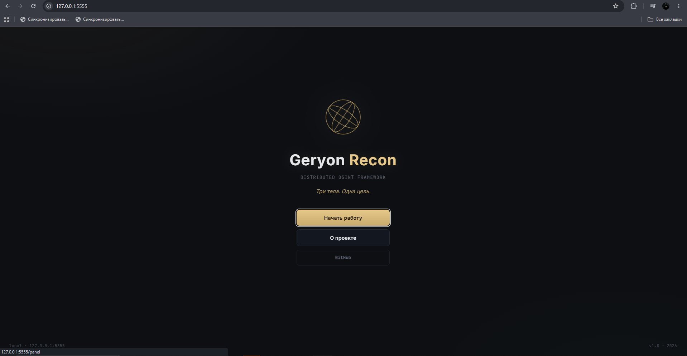
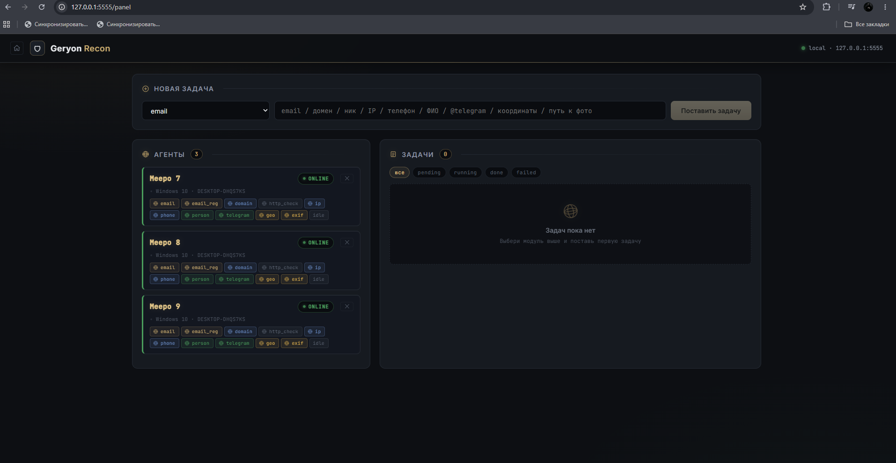
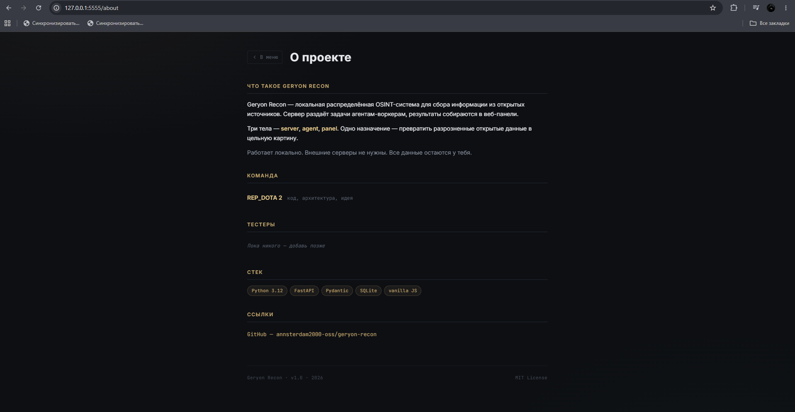

# Geryon Recon

*Distributed OSINT framework. Three bodies, one purpose.*

> Named after **Geryon** — the three-bodied king of Tartessos, at the edge of the known world.
> This project lives on another edge.
>
> *Сервер. Агенты. Панель. Три тела — одна цель.*

---

## Что это

**Geryon Recon** — локальная распределённая OSINT-система для сбора информации из открытых источников.

Сервер раздаёт задачи агентам-воркерам, результаты собираются в веб-панели. Работает **локально**, внешние серверы не нужны. Каждый агент — **голова Гериона**: возьмёт задачу, выполнит, отдаст результат.

## Страницы

| URL | Что это |
| --- | --- |
| `/` | Главное меню |
| `/panel` | Рабочая панель (задачи, агенты) |
| `/about` | О проекте, команда, стек |

## Скриншоты

### Главное меню



### Панель задач



### О проекте



## Архитектура

- **`server/`** — FastAPI-сервер, оркестратор задач
- **`agent/`** — воркеры, выполняют задачи
- **`panel/`** — веб-панель управления

## OSINT-модули

| Модуль | Что собирает |
| --- | --- |
| `email` | MX, A-записи, Gravatar |
| `email_reg` | где email зарегистрирован (holehe) |
| `domain` | WHOIS, DNS, поддомены, SSL, HTTP |
| `username` | 35+ сайтов через распределённые подзадачи |
| `ip` | гео, ASN, PTR, RIR-whois |
| `phone` | оператор, регион, тип линии |
| `person` | поиск по ФИО в открытых источниках |
| `telegram` | проверка публичного аккаунта по @username |
| `geo` | координаты / адрес → адрес + что рядом (100 м) |
| `exif` | метаданные фото (GPS, дата, устройство) |

## Мониторинг железа

Отдельный модуль `sysinfo` собирает состояние машины, на которой запущен агент. Работает через **LibreHardwareMonitor** (LHM) — локальный web-сервер на `localhost:8085`.

Агенту **не обязательно** иметь LHM: если он не запущен, `sysinfo` вернёт `{"available": false, "reason": "..."}`, и агент продолжит работу.

**Что собирает:**

| Поле | Описание |
| --- | --- |
| `cpu_load` | загрузка CPU (`CPU Total`) |
| `cpu_temp` | температура (`Core (Tctl/Tdie)` или `CPU Package`) |
| `gpu_load` | загрузка GPU (`GPU Core`, только из `/load/`) |
| `gpu_temp` | температура GPU (`GPU Core`, только из `/temperature/`) |
| `ram_used` | занятая оперативная память |
| `ram_avail` | доступная оперативная память |
| `disk_free` | свободно на системном диске |
| `disk_total` | всего на системном диске |
| `disk_used_pct` | процент занятости диска |

**Как это работает:**

1. Агент при регистрации шлёт `hardware` в теле `POST /register`.
2. При каждом heartbeat (`POST /heartbeat/{bot_id}`) — обновляет `hardware` в `info` бота.
3. Сервер складывает `hardware` в `BOTS[bot_id]["info"]["hardware"]` и в SQLite (колонка `hardware`).
4. Панель рендерит строку железа в карточке агента.

**Требования:**

- Windows (LHM — Windows-only).
- LHM запущен **от админа**.
- Включён web-сервер: **Options → Remote Web Server → Run** (порт `8085`).
- `http://localhost:8085/data.json` отдаёт JSON.

**Если LHM не установлен** — модуль просто вернёт `available: false`, панель покажет агента без строки железа. Остальные модули работают как обычно.

## Возможности

- **Распределённая обработка** — несколько агентов параллельно
- **Подзадачи** — `username` разворачивается в 35 http-проверок, `geo` — в Nominatim + Overpass
- **Мониторинг железа** — CPU/GPU/RAM/SSD через LibreHardwareMonitor
- **Уведомления в Discord** — о завершённых задачах
- **SQLite** — история задач и ботов сохраняется между запусками
- **Веб-панель** — прогресс-бары, фильтры, экспорт результатов, красивый рендер каждого модуля
- **Отказоустойчивость** — задача вернётся в очередь, если агент упал
- **Reconnect** — агент сам переподключается к серверу

## Зависимости

```bash
pip install -r requirements.txt
```

## Запуск сервера

```bash
cd server
python server.py
```

## Что должно быть в логе

```text
[*] Geryon Recon — listening on http://0.0.0.0:5555
[+] DB initialized: C:\projects\geryon-recon\server\osint.db
[+] loaded 0 bots, 0 tasks from DB
INFO:     Uvicorn running on http://0.0.0.0:5555
```

## Запуск агентов

Открой второй терминал:

```bash
cd agent
python agent.py --count N
```

Где `N` — количество агентов (голов).

## Что должно быть в логе агентов

```text
[+] little meepo 1 registered modules=['email', 'email_reg', 'domain', ...]
[+] little meepo 2 registered modules=[...]
[+] запущено 3 агентов
```

В панели у каждого агента появится строка железа (если LHM запущен):

```text
CPU 9,5 % · 40,4 °C · GPU 0,0 % · 54,0 °C · RAM 8,7 GB · SSD 42,5 GB/256,1 GB 83,4 %
```

## Как открыть панель

Открой браузер и перейди по адресу:

```text
http://127.0.0.1:5555
```

Ты попадёшь в **главное меню**. Оттуда — **«Начать работу»** → панель, **«О проекте»** → about.

Прямые ссылки:

```text
http://127.0.0.1:5555/panel
http://127.0.0.1:5555/about
```

## Как пользоваться

1. Выбери задачу из списка
2. Введи цель
3. Дождись результата в панели
4. Экспорт результата — кнопка `↓` в карточке задачи (JSON)

## Примеры целей

| Тип | Пример |
| --- | --- |
| email | test@gmail.com |
| email_reg | test@gmail.com |
| domain | github.com |
| username | durov |
| ip | 8.8.8.8 |
| phone | +79161234567 |
| person | Павел Дуров |
| telegram | @durov |
| geo | 55.7558,37.6173 |
| exif | C:\photos\IMG_1234.jpg |

## Доступ по локальной сети

По умолчанию сервер слушает `0.0.0.0` — панель доступна с телефона/планшета в той же сети.

Настройка — в `server/config.py`:

```python
HOST = "0.0.0.0"   # 127.0.0.1 — только локально
PORT = 5555
```

Открыть с телефона: `http://<IP-компа>:5555` (IP узнать командой `ipconfig` в PowerShell).

⚠️ **В общественных Wi-Fi** (кафе, школа) — ставь `HOST = "127.0.0.1"`.

## Уведомления в Discord (опционально)

1. Создай Webhook в Discord:
   правой кнопкой по каналу → **Edit Channel** → **Integrations** → **Webhooks** → **New Webhook**.
   Скопируй URL.

2. Скопируй `server/.env.example` в `server/.env`:

   ```bash
   cd server
   copy .env.example .env
   ```

3. Открой `.env` и вставь Webhook URL:

   ```env
   DISCORD_WEBHOOK_URL=https://discord.com/api/webhooks/...
   ```

4. Перезапусти сервер.

Если `.env` не настроен — уведомления не приходят, но всё остальное работает.

## Структура проекта

```text
geryon-recon/
├── README.md
├── LICENSE
├── .gitignore
├── requirements.txt
├── assets/
│   ├── menu.png
│   ├── panel.png
│   └── about.png
├── server/
│   ├── server.py
│   ├── config.py
│   ├── db.py
│   ├── state.py
│   ├── logic.py
│   ├── notify.py
│   ├── sites.py
│   ├── models.py
│   ├── .env.example
│   └── routes/
│       ├── agent.py
│       └── panel.py
├── agent/
│   ├── agent.py
│   ├── client.py
│   └── modules/
│       ├── __init__.py
│       ├── email.py
│       ├── email_reg.py
│       ├── domain.py
│       ├── http_check.py
│       ├── ip.py
│       ├── phone.py
│       ├── person.py
│       ├── telegram.py
│       ├── geo.py
│       ├── exif.py
│       └── sysinfo.py
└── panel/
    ├── menu.html
    ├── about.html
    ├── panel.html
    ├── menu.js
    ├── panel.js
    ├── panel-fade.js
    ├── about-fade.js
    ├── style.css
    └── modules/
        ├── bots.js
        ├── tasks.js
        ├── details.js
        ├── utils.js
        └── renders/
            ├── index.js
            ├── email.js
            ├── email_reg.js
            ├── domain.js
            ├── username.js
            ├── ip.js
            ├── phone.js
            ├── person.js
            ├── telegram.js
            ├── geo.js
            └── exif.js
```

## Частые проблемы

### Порт 5555 занят

```bash
Get-Process python | Stop-Process -Force
```

### Агенты не подключаются

Проверь, что сервер запущен и открыт `http://127.0.0.1:5555`.

### Панель пустая (404 на `/static/modules/renders/xxx.js`)

Значит, JS-файл рендера отсутствует или лежит не там. Проверь:

- файл существует в `panel/modules/renders/`
- расширение `.js` (не `.js.txt`)
- перезапусти сервер (static может кешироваться)
- `Ctrl+F5` в браузере

### sysinfo: `available: false` / строка железа не появляется

Значит, LHM не отвечает. Проверь по порядку:

1. **LHM запущен?** Открой окно программы.
2. **От админа?** Правый клик → «Запуск от имени администратора». Без этого датчики читаются частично, а web-сервер иногда не поднимается.
3. **Web-сервер включён?** В LHM: **Options → Remote Web Server → Run**. Галочка должна стоять.
4. **Порт 8085?** `netstat -ano | findstr 8085` — должна быть строка `LISTENING`. Если нет — web-сервер не поднялся.
5. **`http://localhost:8085/data.json` открывается?** Если нет — проблема на стороне LHM, не Geryon.
6. **Проверка напрямую**:

   ```bash
   cd agent
   python -c "from modules import sysinfo; import json; print(json.dumps(sysinfo.collect(), indent=2, ensure_ascii=False))"
   ```

   Должно вернуть `available: true` и поля `cpu_load`, `gpu_load` и т.д.

### geo: Overpass вернул 504 / 429 / 406

Модуль `geo` использует два внешних сервиса:

- **Nominatim** (OpenStreetMap) — геокодинг адреса/координат
- **Overpass API** — поиск объектов рядом (кафе, банки, аптеки)

**Overpass — публичный бесплатный сервис**, часто перегружен. Возможные ошибки:

- **504 Gateway Timeout** — сервер не успел обработать запрос. Подожди 30 секунд и повтори.
- **429 Too Many Requests** — превышен rate-limit (1 запрос/сек).
- **406 Not Acceptable** — проблема с заголовками. Обнови `User-Agent` в `geo.py`.

**Что делать:**

1. Подожди 30 секунд и создай задачу снова.
2. Смени зеркало Overpass в `agent/modules/geo.py`:

   ```python
   OVERPASS_URL = "https://overpass.kumi.systems/api/interpreter"
   # альтернативы:
   # OVERPASS_URL = "https://overpass.private.coffee/api/interpreter"
   # OVERPASS_URL = "https://overpass.osm.jp/api/interpreter"
   ```

3. Уменьши `NEARBY_CATEGORIES` — меньше фильтров = быстрее ответ.

**Важно:** если Overpass вернул ошибку — задача всё равно завершится (`status: done`), но без `nearby` (появится `nearby_error`). Адрес из Nominatim всё равно будет.

**Nominatim требует честный User-Agent** с контактом. В `geo.py` замени:

```python
NOMINATIM_USER_AGENT = "geryon-recon/1.0 (твой_email@example.com)"
```

Без этого — могут забанить IP.

### telegram: таймаут / connection error

Модуль `telegram` обращается к `https://t.me/...`. **В РФ `t.me` заблокирован** — без VPN/прокси модуль работать не будет.

**Что делать:**

1. Системный VPN (Amnezia VPN, WireGuard) — Python подхватит автоматически.
2. Или прокси в `agent/modules/telegram.py`.

**Если VPN нет** — модуль вернёт `error: timeout`, задача завершится со `status: failed`. **Это не баг.**

### exif: нет GPS в результате

Модуль `exif` читает метаданные из **JPEG/HEIC**. Если фото **без GPS** (снято без геолокации, скачано из интернета, отредактировано, PNG) — поля `GPS` и `Адрес` **не появятся**. Остальное (дата, устройство, софт) — **будет**.

**Совет:** для теста GPS возьми **свежее фото с телефона**, **не прошедшее через мессенджеры** (Telegram режет EXIF, если отправить «как фото»; если «как файл» — сохраняет).

### holehe не работает

Нужен установленный `.exe`. Проверь:

```bash
python -c "import holehe; print(holehe.__file__)"
```

## Дисклеймер

⚠️ Инструмент предназначен для работы с открытыми источниками и **собственными данными**.

Использование для сбора информации о третьих лицах без их согласия может нарушать законодательство РФ (ст. 137 УК РФ, 152-ФЗ «О персональных данных») и аналогичные законы других стран.

Автор не несёт ответственности за неправомерное использование данного инструмента.

**Соблюдай этику и закон.** OSINT — это про открытые данные, а не про слежку и «пробив».

### Разрешено

- Проверка собственных данных (email, домен, ник, IP, телефон, фото).
- Проверка данных с письменного согласия владельца.
- Проверка публичных персон по открытым источникам (в учебных целях).

### Запрещено

- Сбор информации о третьих лицах без их согласия.
- Использование закрытых/серых баз данных.
- Доксинг, сталкинг, шантаж, слежка.

## Лицензия

MIT License. Подробности — в файле [LICENSE](LICENSE).

## Автор

**REP_DOTA 2** — [github.com/annsterdam2000-oss](https://github.com/annsterdam2000-oss)

Проект разрабатывается в учебных целях с 2026 года.

## Признание

Модуль `sysinfo` был выбран для публичного индекса [XERJ Corpus Hub](https://xerj.org) — open-source поисковой системы для AI-агентов, которая экономит токены, возвращая точные фрагменты кода вместо угадывания.

---

> *«Три тела, одна цель. Много голов, один разум. Герион смотрит.»*

---

> *«Quas. Wex. Exort. Server. Agent. Panel.*
> *Три сферы — три тела — один разум.*
> *Десять модулей — десять заклинаний.»*
>
> — **REP_DOTA 2**, ночная сборка